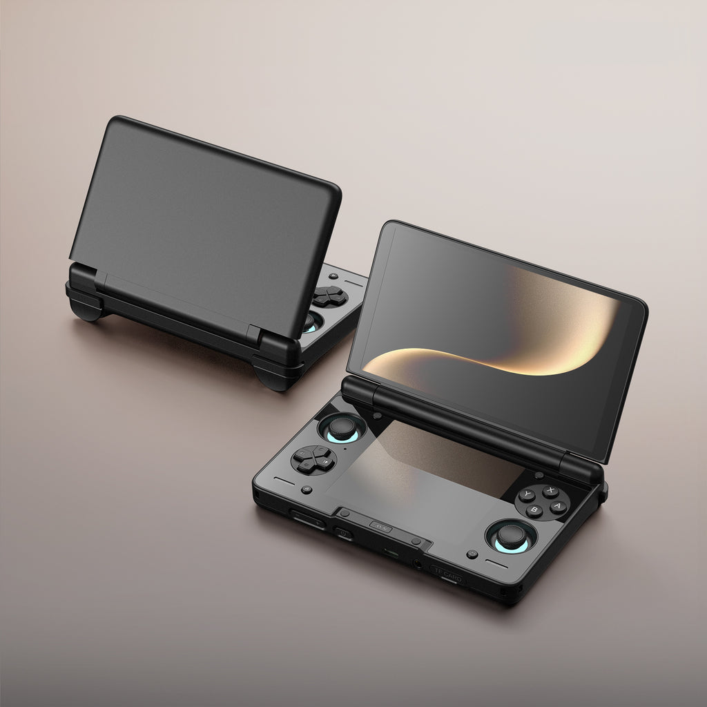
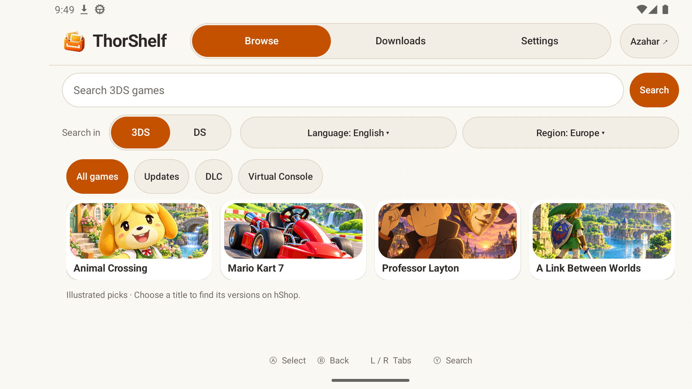
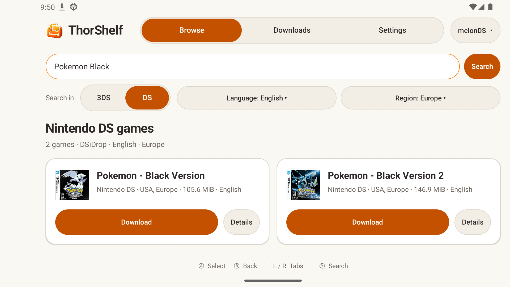
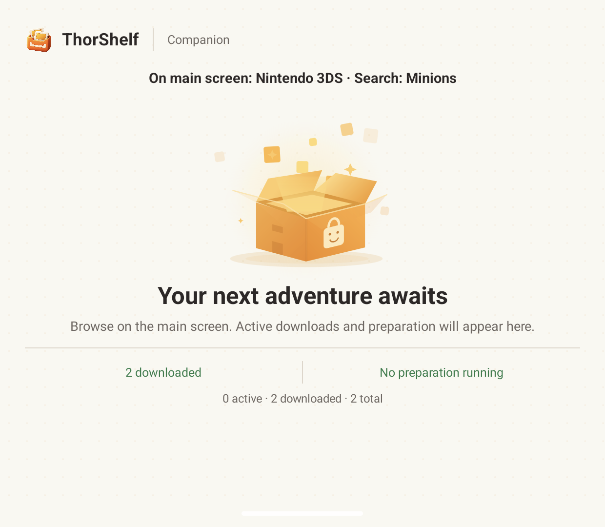

# ThorShelf

**Your GBA, DS & 3DS shelf, on Android.**

Browse games, manage downloads, and save them for **Azahar**, **melonDS**, or your GBA emulator. Made for the **AYN Thor**, with support for other Android devices.

- Search three catalogs with cover art, language and region filters.
- Prepare 3DS games locally and save DS and GBA games to your chosen folders.
- Verify GBA files against their No-Intro size and SHA-1 before marking them saved.
- Navigate with a controller and follow progress on Thor's second screen.
- Follow your device theme, or choose Light, Dark, or OLED black for both screens.

**[Download the latest APK](https://github.com/ZuluagaSD/thorshelf/releases/latest)** · Android 10+ · ARM64 / x86_64

 

## A look inside

| Browse 3DS games | Find your DS edition |
| :---: | :---: |
|  |  |

Thor's companion screen

  

## Where games come from

| Platform | Catalog | Downloads |
| --- | --- | --- |
| **Nintendo 3DS** | [hShop](https://hshop.erista.me/) | hShop's download servers |
| **Nintendo DS** | [DSiDrop](https://github.com/0x1a4-dev/DSiDrop) | [Internet Archive](https://archive.org/details/pack-roms-nintendo-ds-eu-usa-jap-rabbits-games) |
| **Game Boy Advance** | [No-Intro / libretro mappings](docs/GBA_CATALOG.md) | [Central Arquivista on Internet Archive](https://archive.org/details/CentralArquivista-GameBoyAdvance) |

ThorShelf is an unofficial client. Games and emulators are not bundled; install your emulator separately.

The GBA catalog bundles 3,054 matched editions across regions. Language filters use explicit catalog annotations; editions with unknown languages appear when the language filter is cleared. See [catalog provenance and update instructions](docs/GBA_CATALOG.md).

## Set up

1. **Install** the [latest APK](https://github.com/ZuluagaSD/thorshelf/releases/latest). Allow installation from your browser or file manager if Android asks. Install [Azahar](https://github.com/azahar-emu/azahar/releases) for 3DS and/or [melonDS for Android](https://github.com/rafaelvcaetano/melonDS-android/releases) for DS.
2. **Choose folders** in ThorShelf's **Settings**: separate folders for 3DS, DS, and GBA (for example, `ROMs/n3ds`, `ROMs/nds`, and `ROMs/gba`). Add the same folders to your emulators' game libraries.
3. **Find a game** in **Browse**. Select **3DS**, **DS**, or **GBA**, check language and region, choose an edition if prompted, then tap **Download**. Complete hShop verification if prompted.
4. **Save it from Downloads.** 3DS base games are automatically prepared and saved as `.3ds`; tap **Open Azahar** and refresh its library. For DS, tap **Save DS game**, then **Open in melonDS**. For GBA, tap **Save GBA game**; after verification succeeds, open the saved `.gba` from your emulator's library. Direct emulator launching is currently available for DS and 3DS.

If a GBA file fails size or SHA-1 verification, ThorShelf removes its partial saved copy and keeps the original download available. Download the edition again before retrying. A completed download is only labeled **Verified and saved** after the verified copy finishes successfully.

Choose your theme in **Settings → Appearance**. **System** follows Android's light/dark setting; **Dark** uses charcoal surfaces; **OLED black** uses pure black backgrounds and cards without the dotted texture. Your choice also applies to the companion display. Game artwork keeps its original colors.

**Keep in mind:** Wi-Fi only is on by default. 3DS preparation needs roughly **5× the download size** in free internal storage, plus room for the saved game. Updates and DLC still use Azahar's **Install CIA**. If automatic saving is delayed, reopen ThorShelf.

Replacing an older local debug build?

The public release uses a different signing key. Uninstall the debug build first, then install the release APK and select your folders again. App settings and download history are cleared; games already saved in shared folders remain.

---

[Build & development notes](docs/DEVELOPMENT.md) · [Third-party notices](THIRD_PARTY_NOTICES.txt) · [Report an issue](https://github.com/ZuluagaSD/thorshelf/issues)

Thor product image: <a href="https://www.ayntec.com/products/ayn-thor">AYN</a>. In-app covers: <a href="https://www.gametdb.com/">GameTDB</a> and <a href="https://github.com/libretro-thumbnails/Nintendo_-_Nintendo_DS">libretro</a>. <a href="docs/images/SOURCES.md">Image sources</a>.
